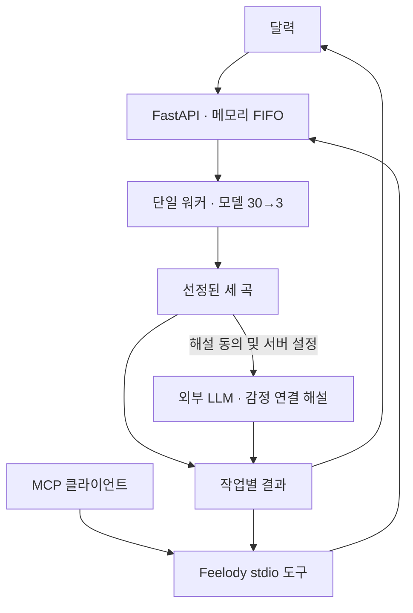

# Feelody: 대기열, 추천 워커, 선택형 AI 해설, MCP

기존 E5-large 검색 30 → KURE 재순위화 3을 그대로 사용한다. 순위 모델 자체나 추천 품질을 개선한 변경은 아니다.



## 실행 (Windows)

1. GitHub의 최신 코드를 내려받고, 이전 **비공개 실행 ZIP의 `artifacts/` 폴더만** 최신 코드의 루트로 복사한다. 예전 ZIP의 Python/웹 파일을 최신 코드 위에 덮어쓰지 않는다.
2. **추천만:** `RUN_LOCAL.cmd`. **추천 이유까지:** `RUN_WITH_REASONS.cmd`. 두 번째 런처에서 키 발급처(openai/gemini), 계정에서 이용 가능한 채팅 모델 ID, API 키를 순서대로 입력한다. 키 입력은 보이지 않으며 런처는 파일에 쓰지 않는다. 이미 같은 이름의 환경변수가 있으면 그대로 사용한다. 두 런처를 동시에 실행하지 않는다.
3. 로컬 달력에서 날짜와 기분을 고르고 일기를 입력한다. 해설을 켠 서버에서만 ‘추천 이유도 보기’가 표시된다. 매번 선택하지 않으면 외부 LLM에 보내지 않는다. 제공사에는 일기와 최종 세 곡의 짧은 가사 발췌만 전송한다. 제공사 정책에 따라 데이터 처리와 비용이 발생할 수 있다. 공개 서비스에서는 제공사로 전송할 권한이 있는 자료만 사용한다.
4. 모델 호스트를 바꾸지 않은 기존 Vercel 화면만으로는 새 워커가 생기지 않는다. 무료 로컬 시연에는 Vercel 환경변수나 유료 배포가 필요 없다. 동봉한 Modal 설정은 요청 후 컨테이너가 유지된다고 가정하지 않도록 동기 경로(`FEELODY_SYNC_ONLY=1`)를 사용하며 해설 키를 배포하지 않는다. 웹은 /healthz에서 경로를 구분한다. 여기서 설명하는 비동기 워커와 MCP는 살아 있는 로컬 모델 호스트를 기준으로 한다.

터미널에서는 `python deploy/start.py local --reasons`가 같은 동작이다. 직접 호스트를 실행하는 경우 `FEELODY_LLM_ENABLED=1`, `FEELODY_LLM_PROVIDER=openai|gemini`, `FEELODY_LLM_MODEL`, 서버 측 `OPENAI_API_KEY` 또는 `GEMINI_API_KEY`가 필요하다. Chat Completions와 JSON 객체 출력을 지원하는 모델을 선택한다. 키를 브라우저 설정, Git, MCP 클라이언트 설정에 넣지 않는다. 프로세스당 최대 10회 호출(실패 포함, `FEELODY_LLM_CALL_LIMIT`로 조절). 재시작하면 초기화되므로 계정의 결제 차단선이 아니다. 외부 공개 전 사용자 인증/요청 제한 및 영속적인 비용 제한을 별도 적용한다.

## 요청 한 건의 생애

- `POST /jobs` 본문 `{"diary":"…","explain":false}` → 202 및 `job_id, access_token`. 작업 ID는 개인 식별자가 아니다. `GET /jobs/{job_id}`에는 `Authorization: Bearer <access_token>`이 필요하다. 토큰은 URL·운영 로그에 쓰지 않는다.
- 상태는 `queued → running → [explaining] → succeeded` 또는 `failed`. 순위가 결정되면 해설을 기다리는 동안에도 세 곡을 읽을 수 있다. 공급자 오류·잘못된 JSON·호출 한도·근거 부족은 해설만 생략한다. 해설은 일기와 발췌를 읽은 **사후 해석**이며 랭커의 내부 판단 근거가 아니다.
- `asyncio.Queue`에 최대 4건 대기, 실행 1건. 선착순으로 처리하고 모델은 백그라운드 스레드에서 계산하여 HTTP 상태 조회를 막지 않는다. 큐가 차면 429, 기존 `POST /recommend`는 같은 큐의 완료까지 기다리는 호환 경로다. 서버를 한 프로세스로 실행한다.
- 원문은 대기·처리 중 메모리에만 유지하고 결과에는 원문/가사를 넣지 않는다. 완료 결과 최대 128건, 최대 10분 동안 조회 가능. 화면을 닫으면 조회는 멈추지만 이미 접수한 작업·외부 호출은 취소되지 않는다. 재시작·컨테이너 교체는 대기 작업과 조회 상태를 잃는다. 여러 인스턴스, 재시작 복구, 워커 분리, 장기 추적이 필요해지면 공유 브로커/결과 저장소와 멱등 키로 확장한다.
- 달력의 기록은 기존처럼 브라우저에 보관한다. 모델 서버가 없으면 일기만 저장하며 샘플 추천을 새 결과처럼 보여주지 않는다.

## MCP: 다른 AI 도구에서 호출하기

MCP 서버는 모델 서버와 별도의 **로컬 어댑터**다. 별도 LLM 키 없이 구동한다. 먼저 위의 로컬 모델 API를 켠다. MCP를 실행할 Python 환경에서 `python -m pip install -r requirements-mcp.txt`를 실행하고, stdio를 지원하는 MCP 클라이언트에 다음과 같이 등록한다. 두 경로를 자신의 실제 절대 경로로 바꾼다.

```json
{
  "mcpServers": {
    "feelody": {
      "command": "C:/path/to/python.exe",
      "args": ["C:/path/to/feelody/feelody_mcp.py"],
      "env": {"FEELODY_MCP_API": "http://127.0.0.1:8765"}
    }
  }
}
```

`submit_diary(diary, explain=false)`가 작업 번호를 돌려주면 `get_recommendation(job_id)`로 조회한다. 현재 MCP 프로세스에서 접수한 작업만 조회 가능하며 모델 호스트는 loopback HTTP만 허용한다. MCP 클라이언트에 입력한 일기는 해당 클라이언트의 데이터 처리 범위에도 들어간다. 외부 설명까지 요청할 때만 explain을 true로 설정한다.

## 검증

`python -m pip install -r requirements-test.txt -r requirements-mcp.txt` 후 저장소 루트에서 `python -m unittest -v tests.test_jobs`. 모델/키 없이 FIFO·429·결과 조회 권한·작업 만료·실패 복구·LLM 실패 시 순위 유지·실제 stdio MCP 왕복을 확인한다. 달력의 요청/응답 처리와 429에서 일기 보존은 `node tests/web-jobs.cjs`로 별도 확인한다. 테스트 추천기는 가상이다. 비공개 인덱스로 실제 모델을 실행하는 검수와 특정 제공사 키로 생성된 설명의 정확성 평가는 별도다. 실제 키로 처음에는 개인 정보 없는 일기 한 편에서만 설명을 켜고 순위 유지, 설명의 가사 근거, 대기시간, 공급자 사용량을 확인한다.

참고: [MCP Python SDK](https://github.com/modelcontextprotocol/python-sdk), [OpenAI Chat Completions](https://platform.openai.com/docs/api-reference/chat/create), [Gemini OpenAI 호환 API](https://ai.google.dev/gemini-api/docs/openai).
