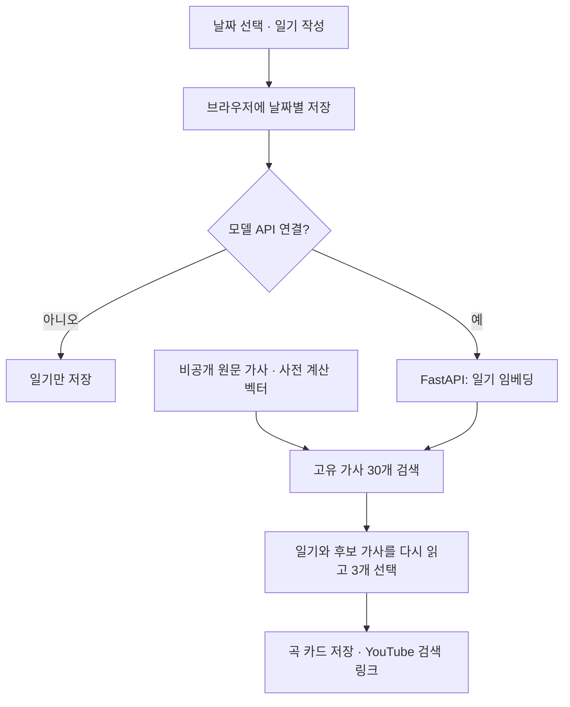
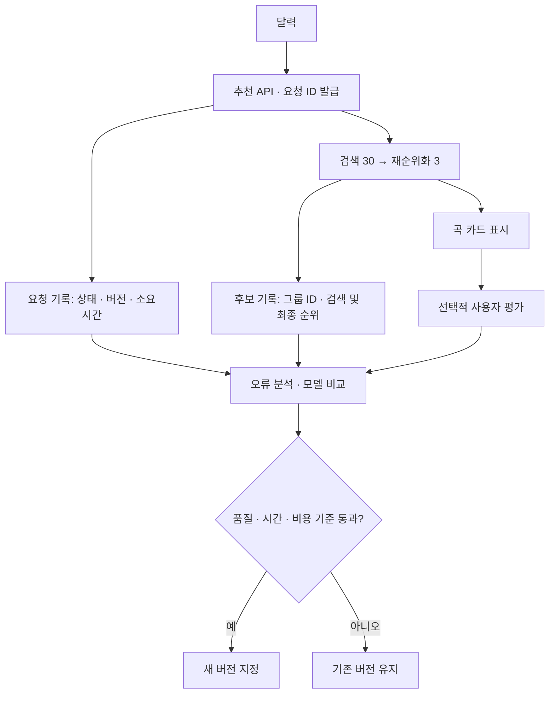

# Feelody 시스템 설계: 일기 한 편에서 감정이 닮은 세 곡까지

**상태:** 현재 구현과 다음 버전의 설계안. 기준 코드 [ecbd25d](https://github.com/sihyeonseo/feelody/tree/ecbd25d00d0de6df1322567004c60b8007600601). 이 문서의 추가만으로 서비스 배포·트래픽·품질 개선을 주장하지 않는다. [평가·포트폴리오 설계](evaluation-and-portfolio.md)와 함께 읽는다.

## 사용자에게 하는 약속

일기를 저장하면 가사에 드러난 감정이 비슷한 K-pop 세 곡을 제안한다. 가족과의 이별을 연인의 이별에 빗대어 들을 수 있다. 따라서 같은 사건·등장인물은 정답 조건이 아니다. 사용자가 선택하거나 수정한 달력 색은 자기 기록이고 추천의 정답 라벨이 아니다. 모델이 응답하지 못해도 일기는 남기고, 미리 골라 둔 곡을 새 추천으로 보여주지 않는다.

## 현재: 어디서 무엇이 실행되는가

| 책임 | 현재 확인한 동작 | 근거 |
|---|---|---|
| 화면 | 로그인 없는 달력. 브라우저 저장소에 일기·기분·결과를 보관. 서버 주소가 있을 때만 원문 전송. 기기 간 동기화 없음 | [화면](../web/app.js) · [배포 설정](../docs/vercel.md) |
| 검색 | 일기는 요청마다 E5-large로 계산. 가사 그룹은 오프라인에서 계산한 1,024차원 정규화 행렬 사용. 현재 규모 2,242그룹은 행렬 내적으로 정확 검색 | [모델 서버](../live_top3.py) · [집계](../reports/top3_pilot.json) |
| 재순위화 | KURE-nano가 일기–후보 30쌍을 4개씩 처리(입력 최대 512토큰). 3개 그룹에서 대표 곡을 하나씩 반환. 점수 동점은 그룹 ID로 결정 | [모델 서버](../live_top3.py) |
| 서빙 | 시작 시 모델·인덱스 메타데이터/행렬 검사. CPU 또는 GPU 사용. 프로세스당 한 요청 처리, 이미 처리 중이면 429. 정적 웹과 모델 호스트 분리 가능 | [모델 서버](../live_top3.py) · [실행·연결 안내](../docs/vercel.md) |
| 증거의 경계 | 실행 코드·실험 집계·클라우드 실행 절차는 공개되어 있다. 공개 모델 호스트의 현재 가동, 실사용자 수, 운영 지연시간은 이 설계에서 확인하지 않았다 | [README](../README.md) · [공개 실험 결과](../reports/) |

현재 계약은 `POST /recommend`에 `{"diary":"…"}`를 보내고, `songs`의 각 원소에서 `title, artist, searchRank`를 받는 형태다. `GET /healthz`는 준비 상태와 모델 ID를 제공한다. 초기 한 곡 B1/B3 API와 벤치마크는 별도 시스템이다.

## 목표: 한 요청을 설명하고 다음 버전을 선택하는 구조

**그림 속 도구를 Feelody에 대응시키면:** Slack 입력 자리는 달력, 워크플로 도구 자리는 API가 호출하는 검색·재순위 함수, 벡터 DB 자리는 현재의 로컬 행렬이다. 모델 호스트가 결과를 반환한다. 대기열·별도 워커·LLM은 필수 경로에 넣지 않는다. 이 구조는 가사를 *검색하고 순위를 매기는* 추천이며 생성형 RAG는 아니다.

### API와 데이터 경계 (제안, 아직 미구현)

| 경계 | 최소 계약 | 실패·보존 원칙 |
|---|---|---|
| 추천 | 기존 응답을 유지하면서 `request_id`, `pipeline_version`, 곡별 안정적인 `song_id`를 추가 | 성공은 서로 다른 그룹 정확히 3개. 빈 입력/4,000자 초과 422, 처리 중 429, 서버 미가용·시간 초과는 저장 완료와 추천 실패를 분리. 재시도는 사용자 선택 |
| 서버 측 추적 | `requests(request_id, time, version, status, device, cold_start, retrieve_ms, rerank_ms, total_ms)`; `candidates(request_id, group_id, search_rank, final_rank?)` | 30개 후보 중 어디서 탈락했는지 복원. 원문·토큰·가사·벡터·IP는 분석 로그에 쓰지 않는다. 오류 본문과 호스트 기본 로그도 점검 |
| 곡별 피드백 | `POST /feedback {request_id, song_id, fit}`, fit은 ‘맞음/아님’. 요청에 실제 노출된 곡만 허용. 같은 요청·곡 재평가는 갱신 | 미응답을 부적합으로 바꾸지 않는다. 클릭은 청취 의향의 보조 신호. 감정 적합도와 구별 |
| 저장 | 일기 원문은 브라우저에, 일시적인 추론만 서버에서. 파일럿 추적·평가는 지속 볼륨이 있는 단일 호스트라면 SQLite로 시작 | 임시 디스크만 있는 호스팅에서는 영속성 가정 금지. 운영 전 보존기간(초안 30일), 삭제 절차, 기록 중단 스위치 결정. 공개 Git에는 집계와 가상 예시만 |
| 관측 | 서버 처리시간과 화면의 제출→카드 표시 시간을 따로 측정. 모델 로딩·대기·네트워크 시간을 구분 | 성공률, 429, 시간 초과, 버전별 p50/p95를 분모·표본 수와 함께 보고. 브라우저 본문을 오류 추적 서비스로 전송하지 않음 |

추천 요청 ID는 임의값으로 생성하고 로그인·개인 식별자로 쓰지 않는다. 로컬 DB는 모델 인덱스와 별도다. 사용자가 일기를 다시 편집하면 이전 결과를 새 원문의 결과로 연결하지 않는다. 피드백 저장이 실패해도 이미 받은 추천은 계속 볼 수 있어야 한다.

### 오프라인 준비와 운영 결정

1. **인덱스:** 비공개 카탈로그 → 원문 정규화·동일 가사 그룹화 → 임베딩 블록 → manifest. 모델 revision, 전처리 버전, 그룹 순서/해시, 차원, 파일 목록을 묶어 관리한다. 버전이 다른 일기 인코더와 가사 벡터를 섞지 않는다.
2. **릴리스:** 같은 시험 일기에 기존 버전과 후보 버전을 실행해 품질·시간·비용을 기록한다. 코드 SHA, 모델 두 개의 revision, 인덱스 해시, 환경, 평가셋 버전을 한 묶음으로 보관한다. 불일치하면 준비 상태를 열지 않고, 이전 모델·인덱스 묶음으로 복귀한다.
3. **호스팅:** 첫 통합 검수는 로컬에서 한다. 공개 웹과 추론 호스트는 분리한다. 공개 데모의 비용 상한은 **자동 초과 청구 없는 0원**이다. 기존 모델을 무료로 제공할 수 있는지와 다른 관리형 모델로 바꾼 경우의 품질은 별개의 검증 사항이다. 조건을 못 맞추면 공개 웹은 일기 저장/명시적 실험 예시, 실제 모델은 로컬 시연으로 운영한다. 브라우저 설정에는 API 키를 넣지 않는다.
4. **장애·남용:** 모델 미연결, 잘못된 인덱스, 동시 요청, 호스트 한도 소진, 사용자 취소를 각각 시험한다. CORS는 호출자 인증이 아니다. 공개 전 서버 측 요청 제한과 할당량 소진 시 중단 경로를 검증한다.
5. **확장 조건:** 동시 요청 거절이나 긴 대기가 반복되면 먼저 길이·배치별 병목을 측정한다. 비동기가 실제로 필요하면 `POST /jobs → 202 + job_id → 상태 조회 → 결과`를 추가한다. 만료·중복 요청·취소·일기 임시 보존을 함께 설계한다. 카탈로그가 커져 정확 검색이 지연 예산을 넘을 때에만 근사 벡터 검색을 정확 검색 대비 검증한다.

## 구현 순서와 인수 기준

| 순서 | 작업 | 다음 단계로 가는 증거 |
|---|---|---|
| 1 | 현재 모델과 달력의 통합 검수, 요청 추적 | 가상 일기 1편의 UI 결과와 후보 기록의 최종 3곡이 일치. 서버 종료 시 일기만 남고 가짜 카드 없음. 원문이 서버 기록에 없음을 확인 |
| 2 | 실패 위치 진단과 개선 실험 | [평가 계획](evaluation-and-portfolio.md)의 동일 후보 비교표, 실패 반례, 블라인드 채점 및 지연 측정 결과 |
| 3 | 비용 제한을 지키는 소규모 데모와 피드백 | 사이트에서 서로 다른 새 입력으로 실제 API 왕복 확인. 오류·피드백·한도 소진을 점검하고 공개 기간/요청 수 명시 |
| 4 | 운영 결과로 다음 결정 | 실제 사용자 평가와 오프라인 채점 분리, 어떤 변경을 채택 또는 기각했는지와 롤백 가능성 기록 |

로그인·기기 간 동기화, 감정 분류 피처, 벌스별 임베딩, 대기열은 현재 범위 밖이다. 특히 로그인 도입은 중앙에 일기를 보관하는 별도 제품 결정이므로 데모 운영에 묶지 않는다.
